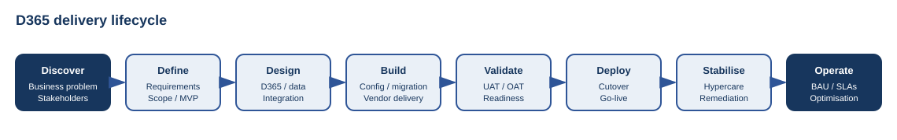
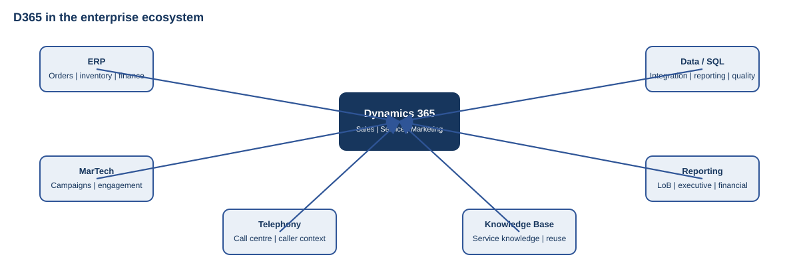

# D365 Program Recovery & Delivery

A practical case study of stabilising and delivering a Microsoft Dynamics 365 customer platform following earlier implementation difficulties.

The case study is intentionally organisation-neutral and focuses on the delivery method rather than the company.

> **Status:** Completed case study / reference material  
> **Last reviewed:** October 2026

---

## What it covers

- Program reset and business requirements
- Sales journey and customer service case management
- Telephony / call-centre integration and knowledge management
- ERP, MarTech, SQL and reporting integration
- Vendor risk, contract and commercial management
- RACI, Steering Committee, RAID, matrix management and communications
- Temporary and permanent capability for delivery and BAU
- UAT, OAT, training, cutover and go-live
- Hypercare and transition to BAU
- Cross-module, line-of-business and financial reporting

## Delivery lifecycle

## Enterprise integration view

## Governance and communication

## Detailed case study

See [`docs/case-study.md`](docs/case-study.md).

## Purpose

This repository is a public technology-leadership case study.

It focuses on transferable lessons around business ownership, delivery governance, vendor accountability, integration, adoption and operational transition.

Organisation names, client data, commercial terms and identifying implementation details are intentionally excluded.
